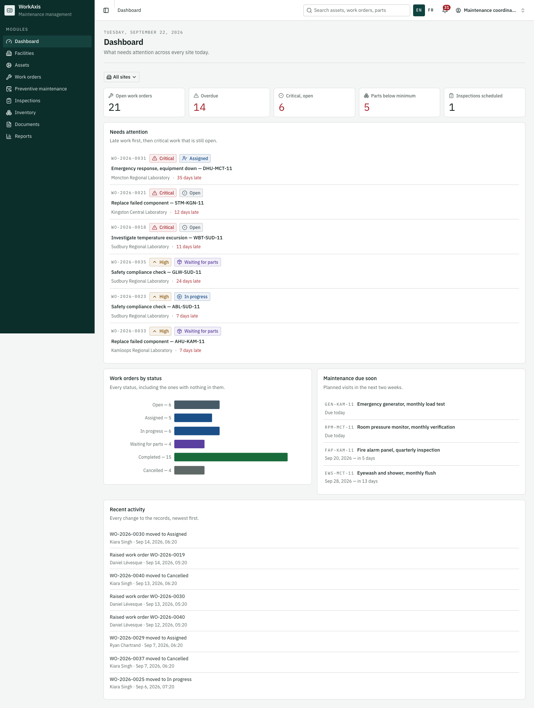
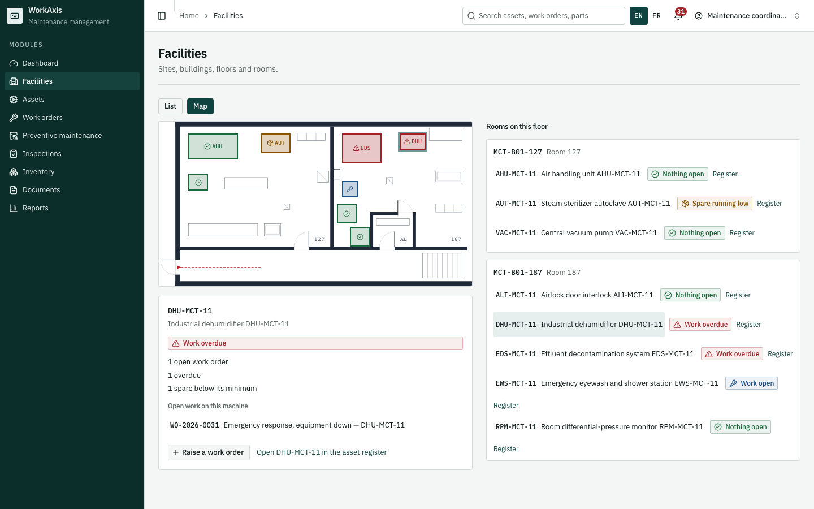
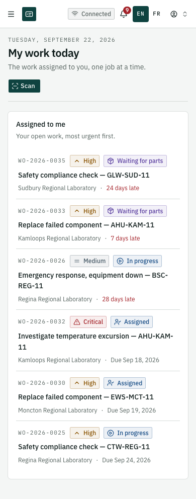
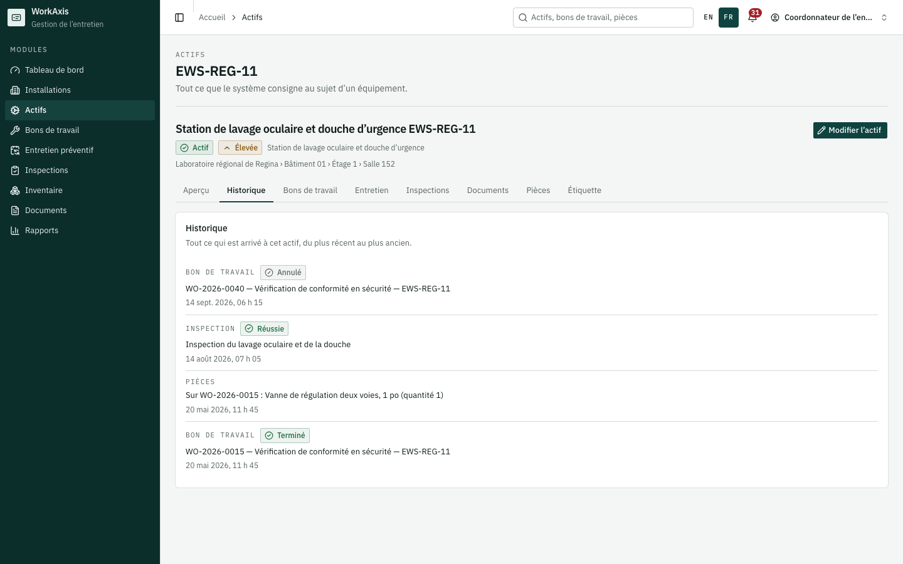
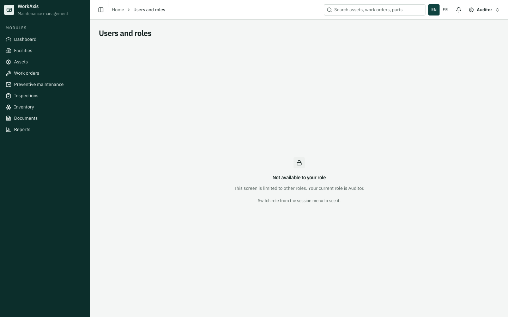

# Open CMMS

*A maintenance management system for facilities. The application calls itself WorkAxis in its own interface, which is the name you will see in the screenshots.*

**A maintenance management system for facilities, built to government procurement standards. Bilingual, works offline, and tested for accessibility.**

Assets, work orders, preventive maintenance, spare parts, documents, floor plans and reporting — in English and French, on a desk or on a phone, with or without a network connection.

This is a working demonstration on synthetic data. There is no backend and no sign-in: everything runs in the browser against a seeded store, so you can open it and use it immediately.

```bash
npm install
npm run dev     # http://localhost:3000
```

---

## Why this exists

It was built to bid on a Canadian federal tender for a maintenance system across a network of laboratories. That bid did not go ahead, for reasons that had nothing to do with the software: the buyer later required a security certification that takes months to obtain.

The requirements were real, though, and they are more demanding than a typical side project. Full bilingual operation including reports and notifications. Offline use with conflict resolution. Accessibility to WCAG 2.1 AA. Barcode and QR scanning. Role-based permissions. That is what shaped this, and it is why it looks the way it does.

## What is interesting in here

**It genuinely works offline.** Not a cached page. You can raise and complete work with no connection, the changes queue, and when you reconnect they replay. Where the same record changed in two places, you are shown both versions and asked which wins.

**It is bilingual all the way down.** Every string comes from a catalogue, including the column headings in exported reports and the sentences in the activity trail. A test fails the build if any string is hardcoded. Another test catches French contractions before vowels, because five of the six work-order statuses begin with one.

**Permissions are shown, not hidden.** When your role cannot do something, the button stays visible, goes grey, and tells you which rule stopped you and how to get access. Hiding controls teaches people the software is broken. Explaining them teaches people how the organisation works.

**The floor plan is an architectural drawing.** Walls have thickness, doors have swing arcs, the stairs are drawn as treads, and every piece of equipment is its own true footprint at its real size rather than a repeated icon. You click equipment on the plan to raise work against it. A test samples every door's swing at each degree of travel and fails if a door opens into furniture.

**Everything is in one place and nothing is a mock.** Seeded data covers a network of sites with assets, plans, parts, documents and history, all internally consistent, so the reports show believable numbers rather than lorem ipsum.

## Screenshots

|                                                                                 |                                                                                |
| ------------------------------------------------------------------------------- | ------------------------------------------------------------------------------ |
|                      |                  |
|  |  |

Permissions are explained rather than hidden:



## Built with

Next.js 16 · TypeScript in strict mode · Tailwind v4 · shadcn/ui · zustand persisted to IndexedDB · next-intl · Vitest · Playwright · axe

## Testing

The interesting part of this project is arguably the tests rather than the features.

- **2,600+ unit tests** and **600 browser tests**, run against a real build.
- **Accessibility scanned** on every screen at three widths, in both languages.
- **The suite fails if it did not run what it collected.** A run once silently dropped ninety tests and still reported success. Now every run prints how many tests it collected against how many it executed, and accounts for the difference. A single unexplained skip fails the build.
- **A parked test must name a ticket**, or the run fails. Otherwise the cheapest way to fix a failing test is to park it.
- **Data fingerprints are pinned per version.** Change the seed without bumping the version and the build fails, because a browser that already has the old data would silently show stale records.

Every safety check in here was verified twice: once by breaking the thing it guards and confirming it fails, and once against correct code it was not written from, confirming it stays quiet. A check that complains about correct work is one the next person switches off.

## Running the checks

| Command             | What it does                                   |
| ------------------- | ---------------------------------------------- |
| `npm run dev`       | Development server                             |
| `npm run build`     | Production build, with type checking           |
| `npm test`          | Unit tests                                     |
| `npm run test:e2e`  | Browser and accessibility tests (builds first) |
| `npm run lint`      | ESLint                                         |
| `npm run typecheck` | `tsc --noEmit`                                 |

Node 22 or newer. The browser tests need Chromium once: `npx playwright install chromium`.

## Finding your way around

- `/en/...` and `/fr/...` are the same application. The switch is in the header and your choice is remembered.
- **The role switcher** is in the session menu, top right. There is no sign-in, so the role you pick decides what you can do and which of the two experiences you get:
  - **Desk** — administrators, facility managers, coordinators, auditors. Tables, planning, configuration.
  - **Field** — technicians and inspectors. Phone-first, today's work only.
- **Settings → Demo controls** puts everything back to its starting state.

## What this is not

Being straight about the edges, because a demo that oversells itself is worse than one that does not.

- **No backend.** Everything is in the browser. Data resets when you clear site data.
- **No sign-in.** The role switcher stands in for authentication, so changing a person's role changes their record and what work they can be given, but not what the current viewer can do.
- **Inspections are a stub.** The screen lists seeded results; there is no template or inspection run.
- **Import reads Excel only.** The requirement named Word and PDF too.

## Licence

MIT. Use any of it.

---

Built solo. If you want the long version of how, `AGENTS.md` holds the rules the codebase is kept to, and `docs/manual/` is a sixteen-chapter user manual written against the actual screens.
